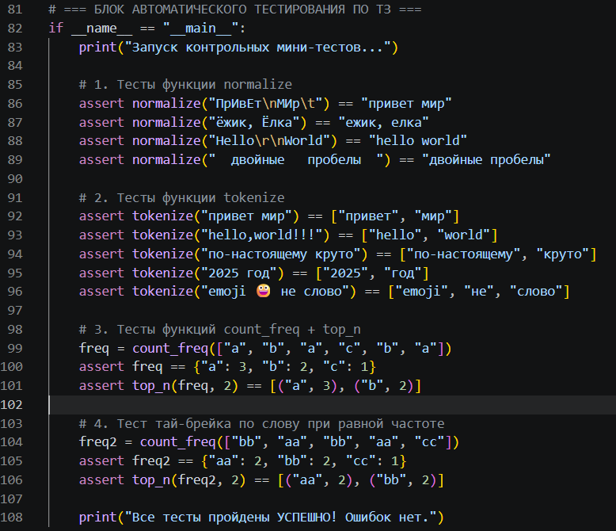
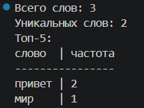
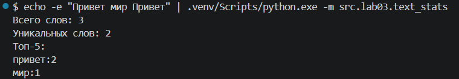

[← Назад в главное меню](../../README.md)

# ЛР3 — Тексты и частоты слов (словарь/множество)

## Задание A - Модуль текста (text.py) — [код](../../src/lib/text.py)

Реализует чистые функции для работы с текстом: нормализацию строки с приведением к casefold и заменой «ё» на «е» (`normalize`), разбиение текста на слова по регулярному выражению с поддержкой дефиса внутри слова (`tokenize`), подсчет частоты каждого слова (`count_freq`) и получение топ-N самых частых слов с сортировкой по частоте и алфавиту при равенстве (`top_n`). Все функции не выполняют ввод/вывод и покрыты `assert`-проверками внутри файла. Переиспользуемая логика вынесена в `src/lib/text.py`.

Для запуска встроенного блока автоматического тестирования используется команда:
```bash
.venv/Scripts/python.exe src/lib/text.py
```

Блок тестов в коде:


Результат их успешного выполнения:


## Задание B - Статистика текста (text_stats.py) — [код](../../src/lab03/text_stats.py)

Скрипт читает текст из stdin (весь ввод до EOF), нормализует и токенизирует его с помощью функций из `src/lib/text.py`, считает общее количество слов, количество уникальных слов и выводит топ-5 самых частых слов в табличном режиме. Расположен в `src/lab03/text_stats.py`.





---

## Способы запуска text_stats.py

Запуск скрипта выполняется из корня репозитория `python_labs` с использованием флага модуля `-m`. Так как программа считывает данные из стандартного потока ввода (`sys.stdin`), передать текст на обработку можно двумя независимыми способами:

### Способ 1. Автоматическая передача строки через конвейер (echo + pipe)
Данный способ удобен для быстрой проверки работоспособности скрипта в одну команду. Утилита `echo` передает строку в поток ввода программы через оператор вертикальной черты (`|`), который автоматически посылает сигнал конца файла (EOF) после передачи текста.

Команда для запуска в терминале:
```bash
echo -e "Привет мир Привет" | .venv/Scripts/python.exe -m src.lab03.text_stats
```

### Способ 2. Интерактивный ввод текста с клавиатуры в консоль
Этот способ используется для ручного ввода больших текстов или копирования многострочных фрагментов. 

1. Запустите скрипт прямой командой:
```bash
.venv/Scripts/python.exe -m src.lab03.text_stats
```
2. После запуска интерпретатор перейдет в режим ожидания ввода. Введите или вставьте любой текст (для перевода строки и ввода нескольких абзацев используйте клавишу **Enter**).
3. Чтобы завершить ввод данных и запустить процесс частотного анализа, отправьте операционной системе сигнал конца файла (EOF). Для этого последовательно нажмите комбинацию клавиш:
   * **Ctrl + Z** (на экране появится символ `^Z`)
   * **Enter**
   