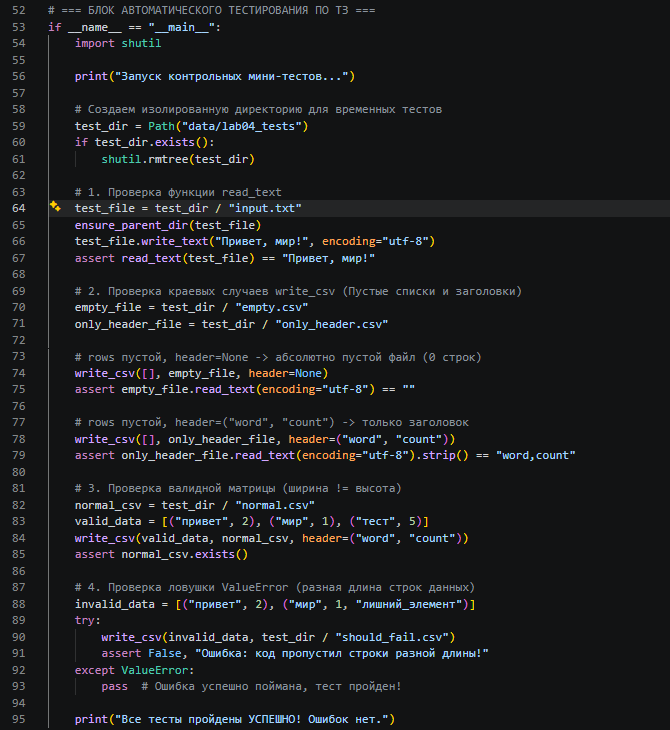
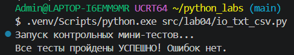
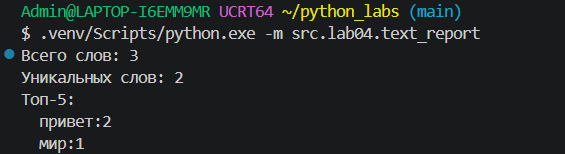

[← Назад в главное меню](../../README.md)

# ЛР4 — Файлы: TXT/CSV и отчёты по текстовой статистике

## Задание A - Модуль ввода/вывода (io_txt_csv.py) — [код](../../src/lab04/io_txt_csv.py)

Реализует чистые функции для работы с файловой системой: автоматическое создание родительских директорий перед записью файлов (`ensure_parent_dir`), чтение текстового содержимого файлов в единую строку (`read_text`) и создание/перезапись табличных CSV-отчётов с разделителем-запятой (`write_csv`). 

Модуль включает строгую валидацию структуры таблиц на равенство длин всех переданных строк данных (иначе генерируется ошибка `ValueError`). В коде принудительно используется параметр `newline=""`, что исключает дублирование переноса строк (`\r\r\n`) на платформе Windows и защищает итоговые таблицы от появления фантомных пустых строк при открытии в Microsoft Excel.

Для запуска встроенного блока автоматического тестирования модуля ввода-вывода используется команда:
```bash
.venv/Scripts/python.exe src/lab04/io_txt_csv.py
```

Блок тестов Задания А в коде:


Результат их успешного выполнения:


## Задание B - Генерация отчёта (text_report.py) — [код](../../src/lab04/text_report.py)

Скрипт выполняет роль главного диспетчера конвейера обработки данных. Он считывает текстовый файл, переиспользует логику нормализации, токенизации и частотного анализа из библиотеки `src/lib/text.py` (ЛР3), выводит краткое резюме статистики в консоль и генерирует итоговую CSV-таблицу.

### Политика обработки краевых случаев:
* **Файл не найден:** Ошибка `FileNotFoundError` перехватывается глобально в диспетчере. Сообщение об ошибке выводится строго в изолированный поток ошибок `sys.stderr`, после чего скрипт аварийно завершает процесс с кодом возврата `sys.exit(1)`.
* **Ошибка декодирования:** При несоответствии кодировок (например, чтение Windows-файла `CP1251` без явного указания параметров) исключение `UnicodeDecodeError` перехватывается, выводится лог в `sys.stderr` и процесс завершается с кодом `1`.
* **Пустой вход:** Если на вход подан пустой текстовый файл, программа возвращает нулевые счётчики слов, а в результирующий CSV-файл записывает только строку заголовка (`word,count`), защищая внешние автоматические парсеры от падений.

---

## Способ запуска text_report.py

Запуск скрипта выполняется из корня репозитория `python_labs` с использованием флага модуля `-m`. Программа автоматически берёт входные данные из пути `data/lab04/input.txt` и сохраняет базовый отчёт в `data/lab04/report.csv`. Строки в CSV сортируются строго по правилу ТЗ: по убыванию частоты (`count` ↓), а при равенстве — по алфавиту (`word` ↑).

Команда для запуска в терминале:
```bash
.venv/Scripts/python.exe -m src.lab04.text_report
```

Результат работы базовой версии на эталонном тексте:

