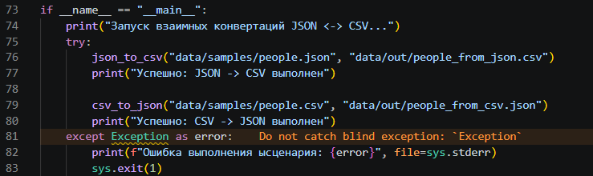
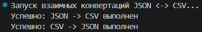
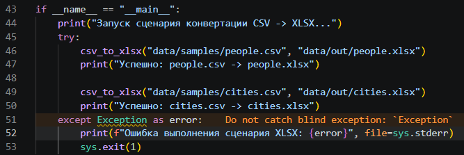
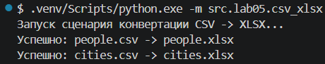
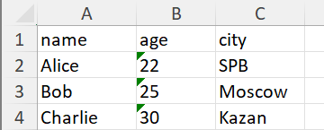

[← Назад в главное меню](../../README.md)

# ЛР5 — JSON и конвертации (JSON↔CSV, CSV→XLSX)

## Задание A — JSON ↔ CSV (json_csv.py) — [код](../../src/lab05/json_csv.py)

Реализует функции `json_to_csv` и `csv_to_json` без вывода в `stdout`. Работает в кодировке UTF-8 с помощью стандартной библиотеки (`json`, `csv`, `pathlib`).

### Допущения:
* **JSON → CSV:** Порядок колонок — как в первом объекте. Новые ключи дописываются в конец заголовка. Отсутствующие поля заполняются пустыми строками (`""`). Запись ведется с `newline=""`.
* **CSV → JSON:** Заголовок обязателен. Все значения сохраняются как текстовые строки (`str`). Сериализация выполняется с `ensure_ascii=False` и `indent=2`.

### Валидация ошибок:
* Отсутствующий файл → `FileNotFoundError`.
* Битый JSON → перехват `json.JSONDecodeError`, вывод описания и строки ошибки в `sys.stderr`, завершение с кодом `1`.
* Пустой JSON, список с не-словарями, пустой CSV или CSV без заголовка → `ValueError`.

Команда для запуска:
```bash
.venv/Scripts/python.exe -m src.lab05.json_csv
```

Результат выполнения конвертаций JSON ↔ CSV в терминале:

Код для проверки:



Результат:



---

## Задание B — CSV → XLSX (csv_xlsx.py) — [код](../../src/lab05/csv_xlsx.py)

Реализует функцию `csv_to_xlsx` с использованием внешней библиотеки `openpyxl` (`requirements.txt`). 

### Допущения:
* Первая строка CSV — заголовок. Лист называется `"Sheet1"`.
* Колонки масштабируются по формуле: `ws.column_dimensions[col_letter].width = max(max_len + 3, 8)`, что добавляет запас в 3 символа к самому длинному значению и ограничивает минимальную ширину столбца в 8 символов.

### Валидация ошибок:
* Отсутствующий файл → `FileNotFoundError`.
* Пустой CSV или файл из одной пустой строки → `ValueError`.

Команда для запуска:
```bash
.venv/Scripts/python.exe -m src.lab05.csv_xlsx
```

Результат успешного экспорта таблиц Excel в терминале:

Код для проверки:



Результат:



---

## Сценарии демонстрации

1. **JSON → CSV:** Конвертация `data/samples/people.json` в `data/out/people_from_json.csv`. Контроль корректности заголовка и совпадения количества строк.
2. **CSV → JSON:** Конвертация `data/samples/people.csv` в `data/out/people_from_csv.json`. Контроль соответствия ключей и количества объектов.
3. **CSV → XLSX:** Конвертация `people.csv` и `cities.csv` в `data/out/people.xlsx` и `cities.xlsx`. Проверка открытия файлов в Excel, имени листа `"Sheet1"` и авто-ширины колонок. 

Проверка корректности сгенерированной структуры и авто-ширины в Excel:


