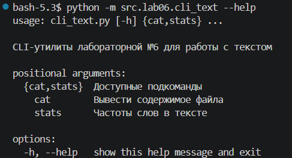
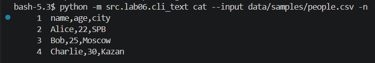
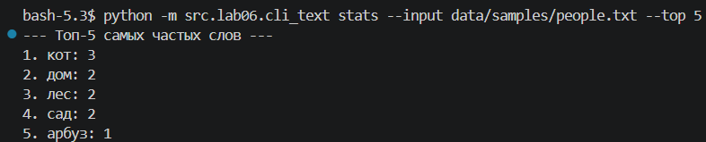
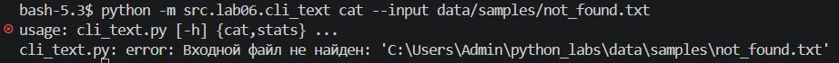
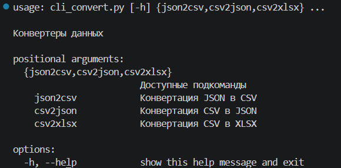
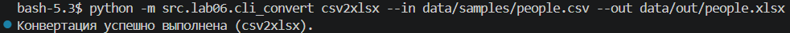
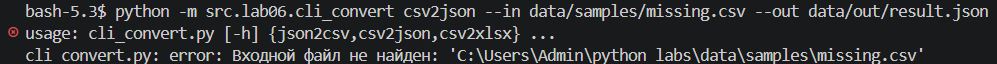

[← Назад в главное меню](../../README.md)

# ЛР6 — CLI-утилиты с argparse (cat/stats + конвертеры)

## Задание A — CLI-работа с текстом (cli_text.py) — [код](../../src/lab06/cli_text.py)

Реализует подкоманды `cat` и `stats` с помощью стандартной библиотеки `argparse`, `pathlib` и `sys`. Использует функции очистки и анализа из `lab03`.

### Допущения:
* **cat:** Построчный вывод файла. Опция `-n` включает порядковую нумерацию через `enumerate(..., 1)` с выравниванием по левому краю (`{:6}`).
* **stats:** Читает файл, передает текст в цепочку функций `normalize` → `tokenize` → `count_freq` → `top_n`. Параметр `--top` ограничивает срез результатов.

### Команды для запуска и проверки справки:
```bash
python -m src.lab06.cli_text --help
python -m src.lab06.cli_text cat --help
python -m src.lab06.cli_text stats --help
```

---

### Демонстрация работы Задания A

**Вывод общей справки и встроенного хелпа подкоманд:**
```bash
python -m src.lab06.cli_text --help
```



**Сценарий проверки 1: Вывод строк с номерами**
```bash
python -m src.lab06.cli_text cat --input data/samples/people.csv -n
```



**Сценарий проверки 2: Вывод топ-слов**
```bash
python -m src.lab06.cli_text stats --input data/samples/people.txt --top 5
```



**Валидация ошибок: Отсутствие входного файла и неверные аргументы**
```bash
python -m src.lab06.cli_text cat --input data/samples/not_found.txt
```



---

## Задание B — CLI‑конвертер данных (cli_convert.py) — [код](../../src/lab06/cli_convert.py)

Реализует изолированные подкоманды `json2csv`, `csv2json` и `csv2xlsx` на базе функционала из `lab05`.

### Допущения:
* Ключ `--in` завязан на внутреннее свойство `dest="input"`, чтобы исключить конфликт синтаксиса с зарезервированным оператором `in` в Python. Ключ `--out` сохранен в `dest="output"`.
* Импорт тяжелых зависимостей (`openpyxl` и функций конвертации) перенесен внутрь блоков `if args.cmd == ...`. Это позволяет вызывать хелп `--help` без установленных внешних библиотек.
* Папка назначения для выходного файла создается автоматически через `mkdir(parents=True, exist_ok=True)`.

### Команды для запуска и проверки справки:
```bash
python -m src.lab06.cli_convert --help
python -m src.lab06.cli_convert json2csv --help
python -m src.lab06.cli_convert csv2json --help
python -m src.lab06.cli_convert csv2xlsx --help
```

---

### Демонстрация работы Задания B

**Вывод встроенного хелпа подкоманд конвертера:**
```bash
python -m src.lab06.cli_convert --help
```



**Сценарий проверки 3: Корректная конвертация `json2csv`**
```bash
python -m src.lab06.cli_convert json2csv --in data/samples/people.json --out data/out/people.csv
```


**Сценарий проверки 4: Корректная конвертация `csv2json`**
```bash
python -m src.lab06.cli_convert csv2json --in data/samples/people.csv --out data/out/people.json
```


**Сценарий проверки 5: Корректная конвертация `csv2xlsx`**
```bash
python -m src.lab06.cli_convert csv2xlsx --in data/samples/people.csv --out data/out/people.xlsx
```



**Валидация ошибок: Отсутствие входного файла (FileNotFoundError) и обработка parser.error()**
```bash
python -m src.lab06.cli_convert csv2json --in data/samples/missing.csv --out data/out/result.json
```


