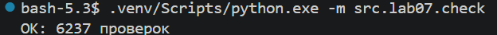
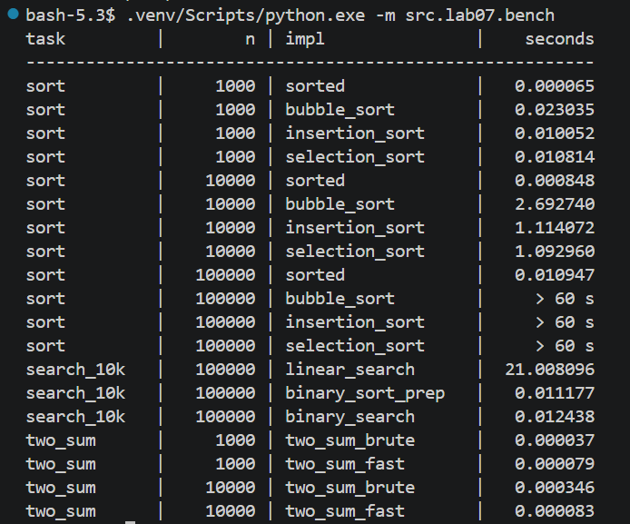
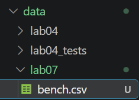

[<- Назад в главное меню](../../README.md)

# ЛР7. Поиск, сортировка и измерение времени

## Задание A. Поиск (`search.py`) ([код](../../src/lab07/search.py))

Реализованы базовые алгоритмы поиска по списку и задача Two Sum двумя способами: `linear_search`, `binary_search`, `two_sum_brute` и `two_sum_fast`.

### Допущения:
* **`linear_search`**: возвращает индекс первого вхождения элемента `x` или `-1`, работает на любом списке за $O(n)$.
* **`binary_search`**: работает за $O(\log n)$ через цикл `while lo <= hi` строго на отсортированном по возрастанию списке (на неотсортированных данных результат не определён).
* **`two_sum_brute` / `two_sum_fast`**: возвращают пару индексов `(i, j)` (`i < j`) или `None`. Быстрая версия использует словарь (`dict`) для поиска недостающего слагаемого за $O(1)$ в один проход ($O(n)$).

## Задание B. Сортировки (`sorting.py`) ([код](../../src/lab07/sorting.py))

Реализованы три квадратичные сортировки своими руками без использования `sorted`, `.sort()`, `min` и `max`: `bubble_sort`, `insertion_sort` и `selection_sort`.

### Допущения:
* Все функции начинают работу с создания копии `arr = list(nums)`, возвращают новый отсортированный список и не изменяют исходный.
* В `bubble_sort` добавлен флаг обменов `swapped` для досрочного выхода ($O(n)$) на уже отсортированных данных.

## Задание C. Проверка против эталона (`check.py`) ([код](../../src/lab07/check.py))

Автоматическое тестирование функций на случайных списках разной длины (включая пустые списки, отрицательные числа и дубликаты) с фиксацией генератора `random.seed(42)`.

### Команды для запуска и проверки справки:
```bash
python -m src.lab07.check
```

### Демонстрация работы Задания C

**Сценарий проверки 1: Прогон всех тестов против эталона (`sorted`, `list.index`, сравнение `two_sum`)**
```bash
python -m src.lab07.check
```
Результат: `OK: 6237 проверок`.



## Задание D. Бенчмарк (`bench.py`) ([код](../../src/lab07/bench.py))

Замеры времени выполнения через модуль `timeit` на одинаковых воспроизводимых наборах данных (`random.seed(42)`) с сохранением результатов в [data/lab07/bench.csv](../../data/lab07/bench.csv) при помощи `write_csv` из ЛР4.

### Команды для запуска:
```bash
python -m src.lab07.bench
```

### Демонстрация работы Задания D

**Сценарий проверки 2: Запуск бенчмарка и вывод сводной таблицы в консоль**
```bash
python -m src.lab07.bench
```



**Сценарий проверки 3: Сформированный файл результатов `data/lab07/bench.csv`**



### Таблица результатов бенчмарка (`data/lab07/bench.csv`)

| task | n | impl | seconds |
| :--- | ---: | :--- | ---: |
| sort | 1000 | sorted | 0.000065 |
| sort | 1000 | bubble_sort | 0.023035 |
| sort | 1000 | insertion_sort | 0.010052 |
| sort | 1000 | selection_sort | 0.010814 |
| sort | 10000 | sorted | 0.000848 |
| sort | 10000 | bubble_sort | 2.692740 |
| sort | 10000 | insertion_sort | 1.114072 |
| sort | 10000 | selection_sort | 1.092960 |
| sort | 100000 | sorted | 0.010947 |
| sort | 100000 | bubble_sort | > 60 s |
| sort | 100000 | insertion_sort | > 60 s |
| sort | 100000 | selection_sort | > 60 s |
| search_10k | 100000 | linear_search | 21.008096 |
| search_10k | 100000 | binary_sort_prep | 0.011177 |
| search_10k | 100000 | binary_search | 0.012438 |
| two_sum | 1000 | two_sum_brute | 0.000037 |
| two_sum | 1000 | two_sum_fast | 0.000079 |
| two_sum | 10000 | two_sum_brute | 0.000346 |
| two_sum | 10000 | two_sum_fast | 0.000083 |

## Выводы

**1. Почему пузырёк при росте $n$ в 10 раз замедляется в ~100 раз, а `sorted` в ~12 раз.**
Сортировки пузырьком, вставками и выбором имеют квадратичную сложность $O(n^2)$: при увеличении размера списка $n$ в 10 раз количество сравнений и перестановок растёт пропорционально $10^2 = 100$. На практике при переходе от $n = 1\,000$ к $n = 10\,000$ время работы `bubble_sort` выросло с `0.023035 с` до `2.692740 с` (в ~117 раз), а на $n = 100\,000$ превысило 60 секунд. Встроенная функция `sorted` использует гибридный алгоритм Timsort со сложностью $O(n \log n)$: при росте $n$ в 10 раз множитель $n$ увеличивает время в 10 раз, а логарифмический множитель $\log_2 n$ меняется незначительно (с $\approx 10$ до $\approx 13.3$, то есть в ~1.3 раза), что даёт суммарное замедление всего в ~13 раз (`0.000065 с` -> `0.000848 с` -> `0.010947 с`).

**2. Почему бинарный поиск бесполезен без предварительной сортировки и когда она окупается.**
Бинарный поиск имеет сложность $O(\log n)$, но работает корректно только на отсортированных данных, так как на каждом шаге отбрасывает половину диапазона за счёт сравнения со средним элементом: на неотсортированном списке он выдаёт непредсказуемый результат. Для разового поиска предварительная сортировка за $O(n \log n)$ невыгодна, поскольку линейный поиск найдёт элемент быстрее, за $O(n)$. Однако при многократных запросах (10 000 поисков по списку из 100 000 элементов) однократная предварительная сортировка (`0.011177 с`) и сами запросы (`0.012438 с`) занимают суммарно `0.023615 с`, что почти в 890 раз быстрее линейного поиска (`21.008096 с`).

**3. Что показал `check.py`.**
Скрипт `check.py` выполнил 6237 автоматических проверок (по 100 случайных прогонов для каждой из трёх сортировок на списках длиной от 0 до 50 с повторами и отрицательными значениями, а также проверки `linear_search`, `binary_search` на крайних и отсутствующих элементах и сверку `two_sum_brute` с `two_sum_fast`). Все тесты завершились успешно (`OK: 6237 проверок`) без расхождений с эталонами.
